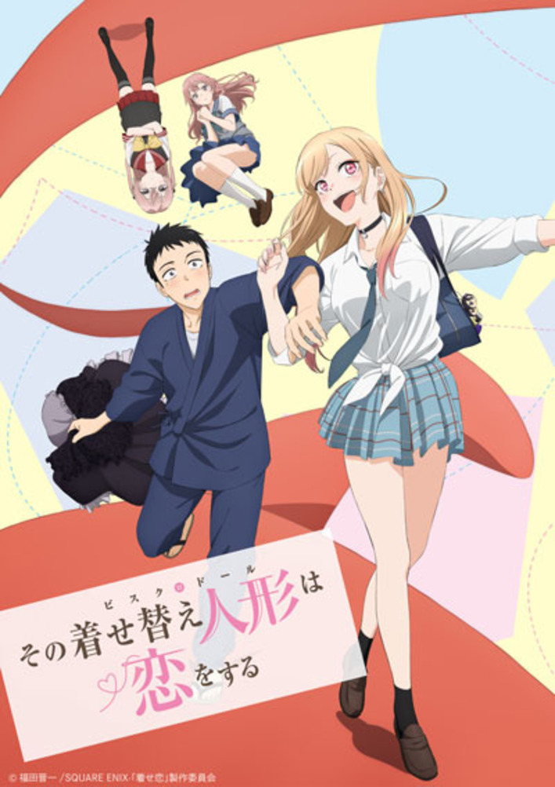
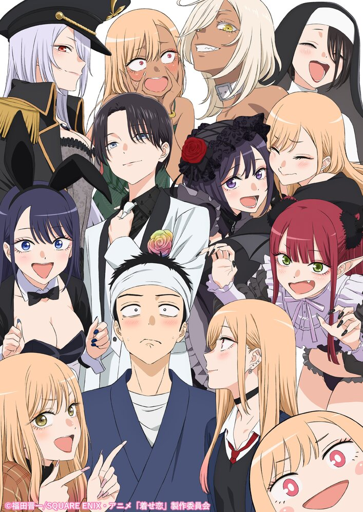
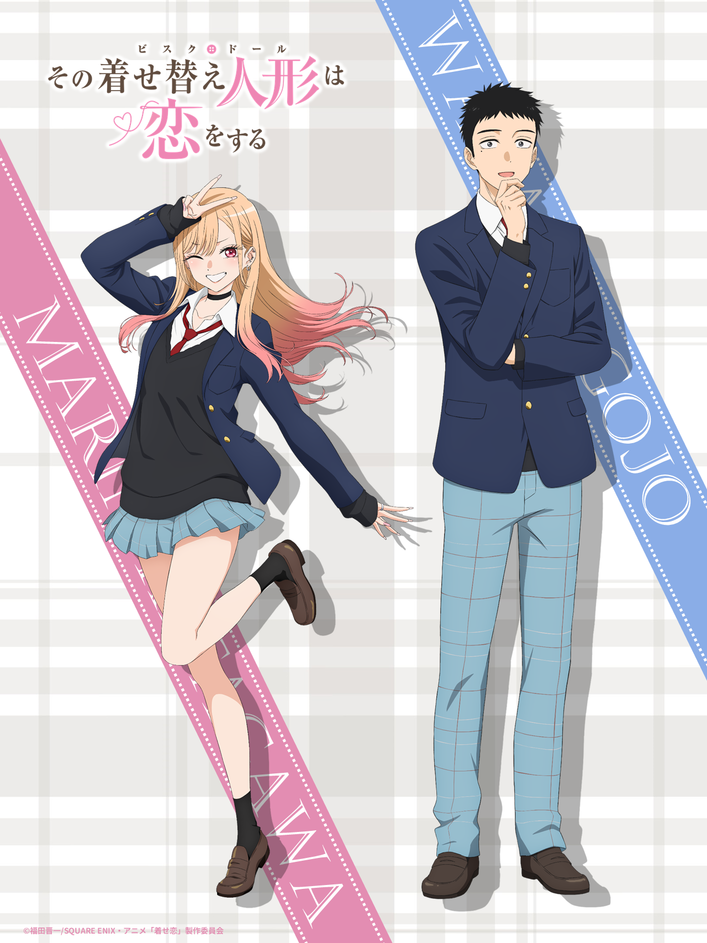
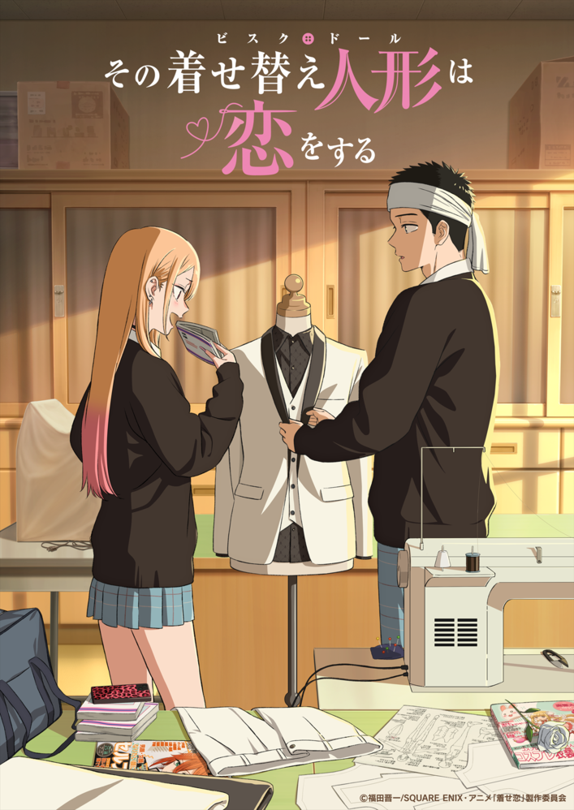
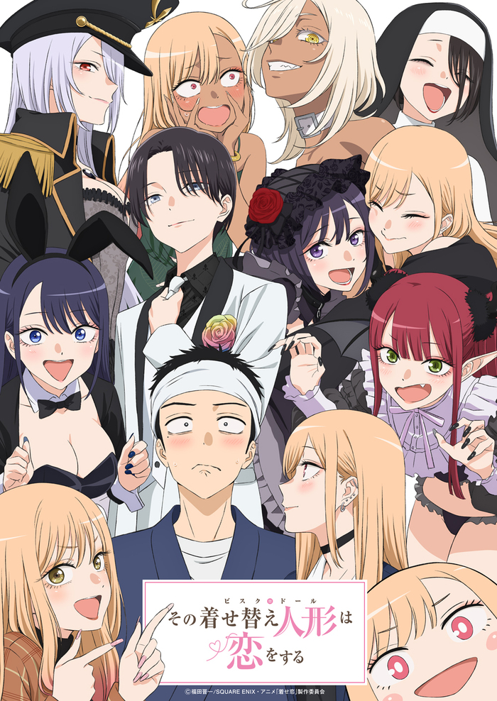

# Galería de arte — *My Dress-Up Darling*

Esta galería reúne visuales promocionales oficiales de las dos temporadas como referencia para estudiar la identidad gráfica del anime: composición, paleta, vestuario, personajes y tratamiento de sus escenas. Las imágenes se guardan en `biblia/galeria/` para que puedan consultarse sin depender de que carguen los sitios externos. Son materiales con derechos reservados; su inclusión aquí sirve como referencia visual y no concede permiso para reutilizarlos, modificarlos o distribuirlos.

## Temporada 1: visual clave

**Título:** Segundo visual clave de la primera temporada. **Tipo:** Arte promocional / visual clave. **Fuente original:** Noticia del sitio oficial del anime [1]; [archivo de imagen original](https://bisquedoll-anime.com/SYS/CONTENTS/7c12fdef-689a-44c2-af06-95fedab585f0/w707). **Crédito y derechos:** © Shinichi Fukuda / SQUARE ENIX / comité de producción de *Kisekoi*. Derechos reservados; copia local para referencia visual.

## Season 2: visual teaser

**Título:** Visual teaser de Season 2, anunciado junto con la continuación de la serie. **Tipo:** Arte promocional / teaser visual. **Fuente original:** Noticia del sitio oficial del anime [2]; [archivo de imagen original](https://bisquedoll-anime.com/SYS/CONTENTS/353506ce-7d83-48e0-9d59-ab0726f9e04b/w707). **Crédito y derechos:** © Shinichi Fukuda / SQUARE ENIX / comité de producción de *Kisekoi*. Derechos reservados; copia local para referencia visual.

## Season 2: Marin y Wakana

**Título:** Nuevo visual de Marin y Wakana con diseño de Season 2. **Tipo:** Arte promocional de personajes. **Fuente original:** Noticia del sitio oficial del anime [3]; [archivo de imagen original](https://bisquedoll-anime.com/SYS/CONTENTS/e5527f02-f799-4a48-a703-da8a6a5d2109/w707). **Crédito y derechos:** © Shinichi Fukuda / SQUARE ENIX / comité de producción de *Kisekoi*. Derechos reservados; copia local para referencia visual.

## Season 2: visual principal

**Título:** Visual principal de Season 2, ambientado en el taller de Wakana. **Tipo:** Arte promocional / visual principal. **Fuente original:** Noticia del sitio oficial del anime [4]; [archivo de imagen original](https://bisquedoll-anime.com/SYS/CONTENTS/7dc52d1b-4a13-4973-b0d2-e91b7c7f0cf3/w707). **Crédito y derechos:** © Shinichi Fukuda / SQUARE ENIX / comité de producción de *Kisekoi*. Derechos reservados; copia local para referencia visual.

## Póster de Season 2

**Título:** Visual de Season 2 publicado en la ficha de Aniplex. **Tipo:** Póster / imagen promocional. **Fuente original:** Ficha oficial de Season 2 de Aniplex [5]; [archivo de imagen original](https://www.aniplex.co.jp/SYS/CONTENTS/keyvisual_bisquedoll-anime2/w700). **Crédito y derechos:** © Shinichi Fukuda / SQUARE ENIX / comité de producción de *Kisekoi*, según el crédito impreso en el material. Derechos reservados; copia local para referencia visual.

## Referencias

[1]: https://bisquedoll-anime.com/news/?article_id=59316 "Segundo visual clave de la primera temporada — sitio oficial del anime"
[2]: https://bisquedoll-anime.com/news/?article_id=66857 "Anuncio del teaser visual de Season 2 — sitio oficial del anime"
[3]: https://bisquedoll-anime.com/news/?article_id=67898 "Nuevo visual de Marin y Wakana para Season 2 — sitio oficial del anime"
[4]: https://bisquedoll-anime.com/news/?article_id=68090 "Visual principal de Season 2 — sitio oficial del anime"
[5]: https://www.aniplex.co.jp/lineup/bisquedoll-anime2/ "Ficha oficial de Season 2 — Aniplex"
